# 9701 A-Level Chemistry: Aliphatic Synthesis Guide

### 1. Alkanes & Alkenes
*Alkanes are generally unreactive except for radical substitution, while the electron-rich C=C double bond in alkenes undergoes electrophilic addition.*

> [!question] Alkane $\rightarrow$ Haloalkane
> 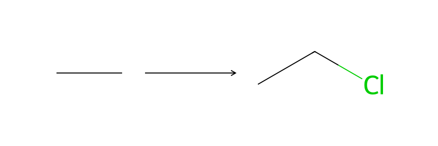
> > [!success]- Conditions & Mechanism
> > **Reaction Type:** Free Radical Substitution
> > **Reagents:** Chlorine ($\ce{Cl2}$) or Bromine ($\ce{Br2}$) gas
> > **Conditions:** UV light
> > **Equation:** $\ce{CH3CH3 + Cl2 -> CH3CH2Cl + HCl}$
> >
> > *Tutor tip:* This reaction produces a mixture of multi-substituted products. UV light provides the activation energy for the homolytic fission (initiation) of the halogen bond.

> [!question] Alkene $\rightarrow$ Dihaloalkane
> 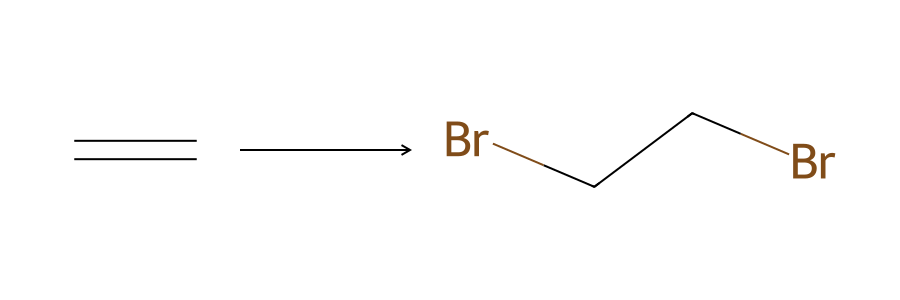
> > [!success]- Conditions & Mechanism
> > **Reaction Type:** Electrophilic Addition
> > **Reagents:** Aqueous Bromine ($\ce{Br2(aq)}$) or Chlorine ($\ce{Cl2}$)
> > **Conditions:** Room temperature, in the dark.
> > **Equation:** $\ce{CH2=CH2 + Br2 -> CH2BrCH2Br}$
> >
> > *Tutor tip:* This is the standard test for a C=C double bond (orange bromine water turns colourless). 

> [!question] Alkene $\rightarrow$ Haloalkane (Markovnikov Addition)
> 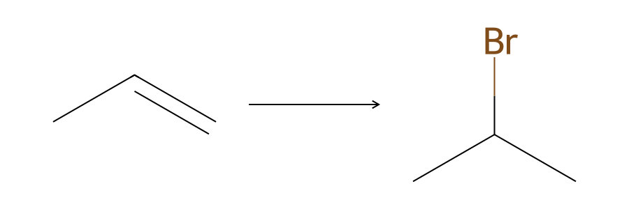
> > [!success]- Conditions & Mechanism
> > **Reaction Type:** Electrophilic Addition
> > **Reagents:** Hydrogen Halide gas (e.g., $\ce{HBr}$)
> > **Conditions:** Room temperature.
> > **Equation:** $\ce{CH3CH=CH2 + HBr -> CH3CHBrCH3}$
> >
> > *Tutor tip:* Markovnikov's rule dictates that the hydrogen attaches to the carbon with the most hydrogens already, forming the most stable carbocation intermediate (tertiary > secondary > primary).

> [!question] Alkene $\rightarrow$ Alcohol (Hydration)
> 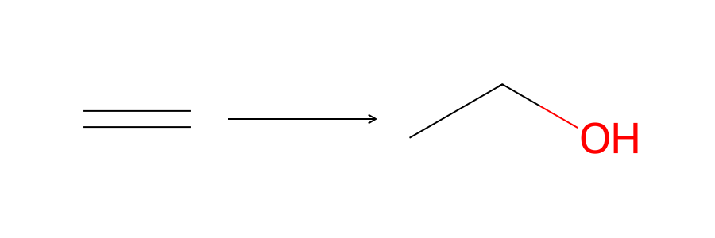
> > [!success]- Conditions & Mechanism
> > **Reaction Type:** Electrophilic Addition
> > **Reagents:** Steam ($\ce{H2O(g)}$)
> > **Conditions:** Concentrated $\ce{H3PO4}$ catalyst, high temperature (300 °C) and high pressure (60 atm).
> > **Equation:** $\ce{CH2=CH2 + H2O -> CH3CH2OH}$

> [!question] Alkene $\rightarrow$ Diol (Mild Oxidation)
> 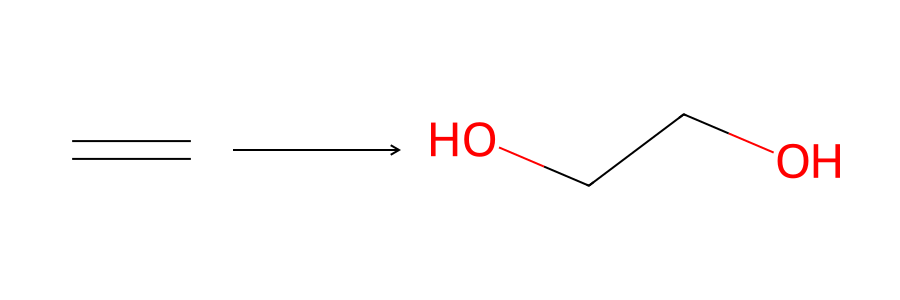
> > [!success]- Conditions & Mechanism
> > **Reaction Type:** Oxidation
> > **Reagents:** **Cold, dilute, acidified** Potassium Manganate(VII) ($\ce{KMnO4}$)
> > **Conditions:** Room temperature.
> > **Equation:** $\ce{CH2=CH2 + [O] + H2O -> CH2(OH)CH2(OH)}$
> >
> > *Tutor tip:* The purple $\ce{KMnO4}$ turns colourless. This is a mild oxidation that simply adds two $-\ce{OH}$ groups across the double bond.

> [!question] Alkene $\rightarrow$ Carbonyls / Carboxylic Acids (Strong Oxidation / Cleavage)
> 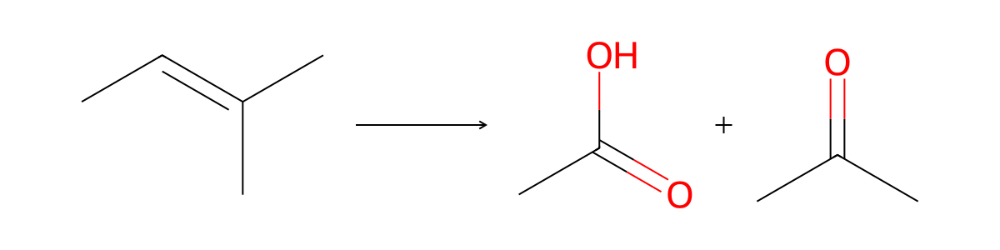
> > [!success]- Conditions & Mechanism
> > **Reaction Type:** Oxidation (Cleavage)
> > **Reagents:** **Hot, concentrated, acidified** Potassium Manganate(VII) ($\ce{KMnO4}$)
> > **Conditions:** Heat under reflux.
> > **Equation:** $\ce{CH3CH=C(CH3)2 + 3[O] -> CH3COOH + CH3COCH3}$
> >
> > *Tutor tip:* The C=C bond completely ruptures! $=\ce{CH2}$ becomes $\ce{CO2}$; $=\ce{CHR}$ becomes a carboxylic acid ($\ce{RCOOH}$); $=\ce{CR2}$ becomes a ketone ($\ce{R2CO}$).

***

### 2. Haloalkanes
*The polar C–X bond makes the carbon susceptible to nucleophilic attack, or the molecule can undergo elimination to form a double bond.*

> [!question] Haloalkane $\rightarrow$ Alcohol
> 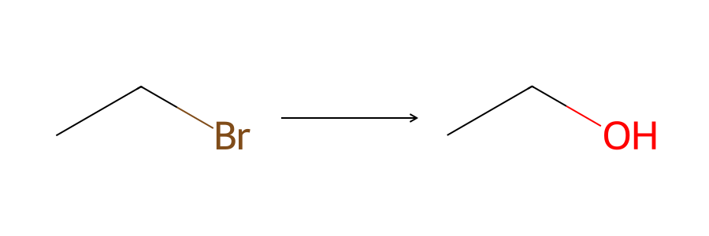
> > [!success]- Conditions & Mechanism
> > **Reaction Type:** Nucleophilic Substitution
> > **Reagents:** Aqueous Sodium Hydroxide ($\ce{NaOH(aq)}$)
> > **Conditions:** Heat under reflux.
> > **Equation:** $\ce{CH3CH2Br + NaOH -> CH3CH2OH + NaBr}$

> [!question] Haloalkane $\rightarrow$ Nitrile
> 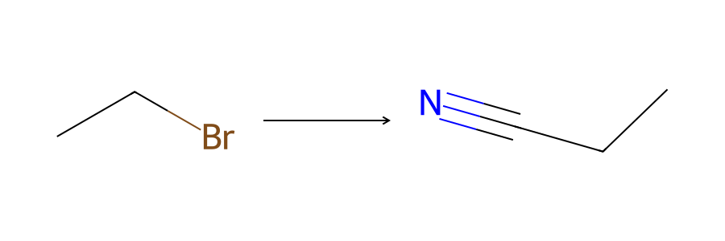
> > [!success]- Conditions & Mechanism
> > **Reaction Type:** Nucleophilic Substitution
> > **Reagents:** Potassium Cyanide ($\ce{KCN}$)
> > **Conditions:** Dissolved in **ethanol**, heat under reflux.
> > **Equation:** $\ce{CH3CH2Br + KCN -> CH3CH2CN + KBr}$
> >
> > *Tutor tip:* This is a crucial step-up reaction for extending the carbon chain by one carbon atom!

> [!question] Haloalkane $\rightarrow$ Primary Amine
> 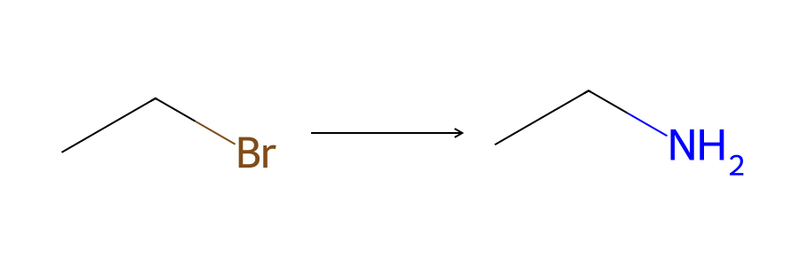
> > [!success]- Conditions & Mechanism
> > **Reaction Type:** Nucleophilic Substitution
> > **Reagents:** Ammonia ($\ce{NH3}$)
> > **Conditions:** Dissolved in ethanol, heated under pressure in a sealed tube (and in **excess** to prevent further alkylation).
> > **Equation:** $\ce{CH3CH2Br + 2NH3 -> CH3CH2NH2 + NH4Br}$

> [!question] Haloalkane $\rightarrow$ Alkene
> 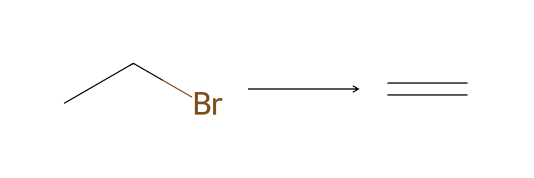
> > [!success]- Conditions & Mechanism
> > **Reaction Type:** Elimination
> > **Reagents:** Sodium Hydroxide ($\ce{NaOH}$)
> > **Conditions:** Dissolved in **ethanol** (NO water), heat under reflux.
> > **Equation:** $\ce{CH3CH2Br + NaOH -> CH2=CH2 + NaBr + H2O}$
> >
> > *Tutor tip:* Compare this with substitution! Aqueous $\ce{NaOH}$ = Alcohol. Ethanolic $\ce{NaOH}$ = Alkene.

***

### 3. Alcohols
*Alcohols undergo oxidation depending on their classification (primary/secondary) and can easily be substituted or dehydrated.*

> [!question] Primary Alcohol $\rightarrow$ Aldehyde (Partial Oxidation)
> 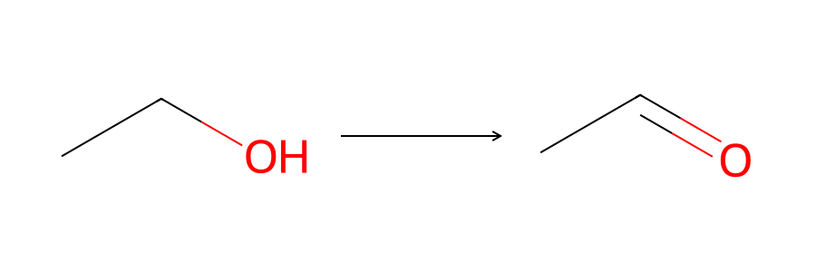
> > [!success]- Conditions & Mechanism
> > **Reaction Type:** Oxidation
> > **Reagents:** Acidified Potassium Dichromate(VI) ($\ce{K2Cr2O7}$)
> > **Conditions:** Heat and **distil** off the product immediately. 
> > **Equation:** $\ce{CH3CH2OH + [O] -> CH3CHO + H2O}$
> >
> > *Tutor tip:* The orange dichromate turns green. Distillation is required because the aldehyde has a lower boiling point than the alcohol and will oxidise further if left in the flask.

> [!question] Primary Alcohol $\rightarrow$ Carboxylic Acid (Full Oxidation)
> 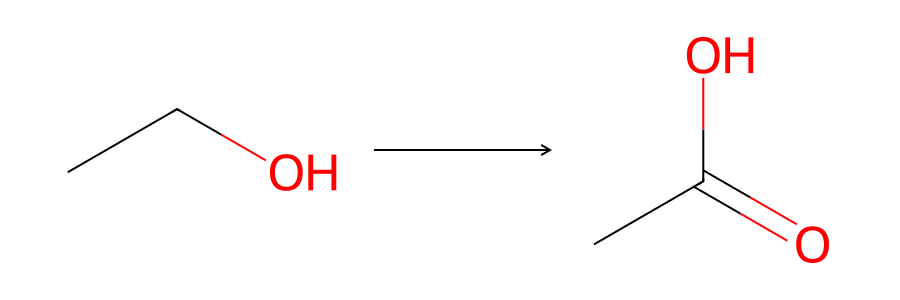
> > [!success]- Conditions & Mechanism
> > **Reaction Type:** Oxidation
> > **Reagents:** **Excess** Acidified Potassium Dichromate(VI) ($\ce{K2Cr2O7}$)
> > **Conditions:** Heat under **reflux**.
> > **Equation:** $\ce{CH3CH2OH + 2[O] -> CH3COOH + H2O}$

> [!question] Secondary Alcohol $\rightarrow$ Ketone
> 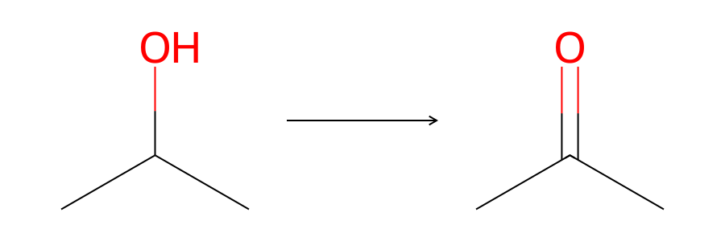
> > [!success]- Conditions & Mechanism
> > **Reaction Type:** Oxidation
> > **Reagents:** Acidified Potassium Dichromate(VI) ($\ce{K2Cr2O7}$)
> > **Conditions:** Heat under reflux.
> > **Equation:** $\ce{CH3CH(OH)CH3 + [O] -> CH3COCH3 + H2O}$
> >
> > *Tutor tip:* Tertiary alcohols cannot be oxidised by dichromate because there is no C–H bond on the alcohol carbon to break.

> [!question] Alcohol $\rightarrow$ Alkene (Dehydration)
> 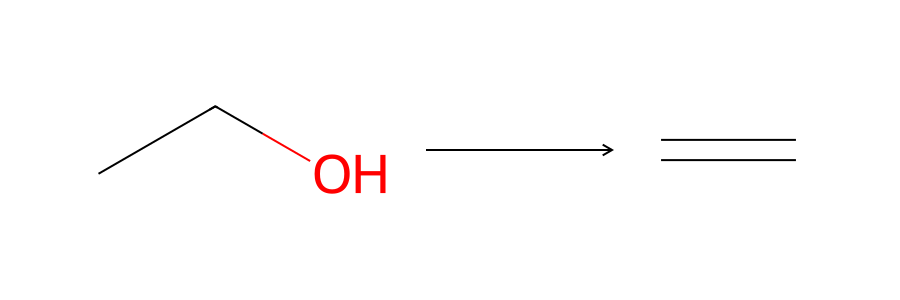
> > [!success]- Conditions & Mechanism
> > **Reaction Type:** Elimination
> > **Reagents:** Concentrated Sulfuric Acid ($\ce{H2SO4}$) or Phosphoric Acid ($\ce{H3PO4}$)
> > **Conditions:** Heat (or pass vapours over heated $\ce{Al2O3}$).
> > **Equation:** $\ce{CH3CH2OH -> CH2=CH2 + H2O}$

> [!question] Alcohol $\rightarrow$ Haloalkane (Chlorination)
> 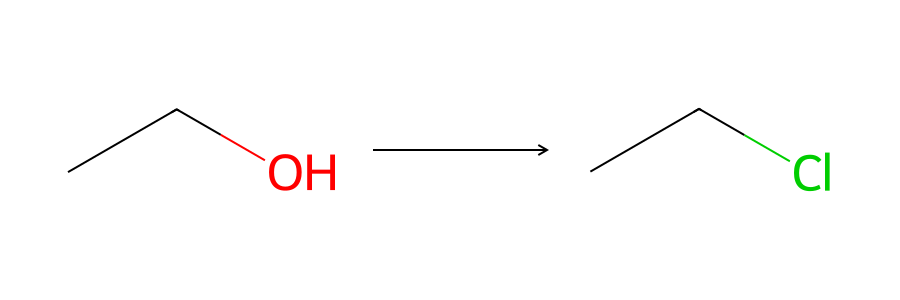
> > [!success]- Conditions & Mechanism
> > **Reaction Type:** Nucleophilic Substitution
> > **Reagents:** Thionyl chloride ($\ce{SOCl2}$), Phosphorus pentachloride ($\ce{PCl5}$), or $\ce{PCl3}$ + heat.
> > **Conditions:** Room temperature (for $\ce{SOCl2}$ and $\ce{PCl5}$).
> > **Equation:** $\ce{CH3CH2OH + SOCl2 -> CH3CH2Cl + SO2(g) + HCl(g)}$
> >
> > *Tutor tip:* $\ce{SOCl2}$ is often preferred because both by-products ($\ce{SO2}$ and $\ce{HCl}$) are gases and escape, leaving pure product.

***

### 4. Carbonyls (Aldehydes & Ketones)
*The C=O bond is polar, making the carbon susceptible to nucleophilic addition. Aldehydes can be further oxidised; ketones cannot.*

> [!question] Aldehyde / Ketone $\rightarrow$ Hydroxynitrile
> 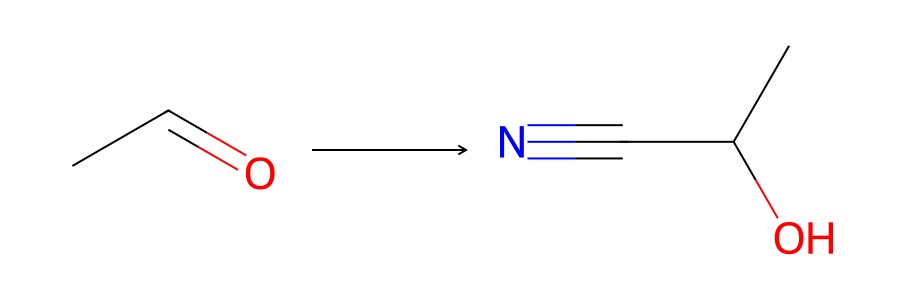
> > [!success]- Conditions & Mechanism
> > **Reaction Type:** Nucleophilic Addition
> > **Reagents:** Hydrogen Cyanide ($\ce{HCN}$)
> > **Conditions:** Room temperature, with a small amount of $\ce{KCN}$ catalyst (to provide initial $\ce{CN-}$ nucleophiles).
> > **Equation:** $\ce{CH3CHO + HCN -> CH3CH(OH)CN}$
> >
> > *Tutor tip:* This is another chain-lengthening reaction. It produces a chiral centre (racemic mixture) if starting from an aldehyde (except methanal) or an asymmetric ketone.

> [!question] Aldehyde / Ketone $\rightarrow$ Alcohol (Reduction)
> 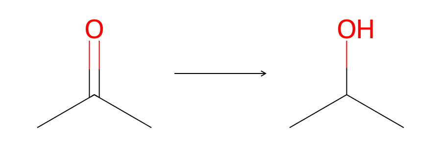
> > [!success]- Conditions & Mechanism
> > **Reaction Type:** Reduction (Nucleophilic Addition)
> > **Reagents:** Sodium tetrahydridoborate ($\ce{NaBH4}$) or Lithium tetrahydridoaluminate ($\ce{LiAlH4}$)
> > **Conditions:** Aqueous/alcoholic solution for $\ce{NaBH4}$; dry ether for $\ce{LiAlH4}$.
> > **Equation:** $\ce{CH3COCH3 + 2[H] -> CH3CH(OH)CH3}$

***

### 5. Carboxylic Acids & Derivatives
*Carboxylic acids react via the acidic $-\ce{OH}$ or undergo condensation to form derivatives (esters, acyl chlorides, amides).*

> [!question] Carboxylic Acid $\rightarrow$ Acyl Chloride
> 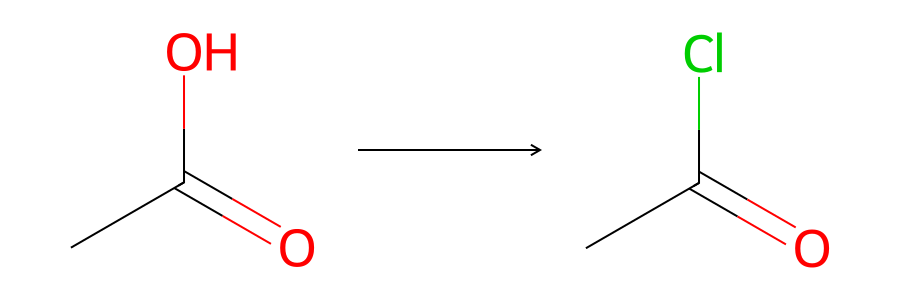
> > [!success]- Conditions & Mechanism
> > **Reaction Type:** Substitution
> > **Reagents:** Thionyl chloride ($\ce{SOCl2}$) or Phosphorus pentachloride ($\ce{PCl5}$)
> > **Conditions:** Room temperature.
> > **Equation:** $\ce{CH3COOH + SOCl2 -> CH3COCl + SO2(g) + HCl(g)}$
> >
> > *Tutor tip:* Acyl chlorides are far more reactive than carboxylic acids, making them excellent intermediates for forming esters and amides without needing an acid catalyst.

> [!question] Carboxylic Acid + Alcohol $\rightarrow$ Ester
> 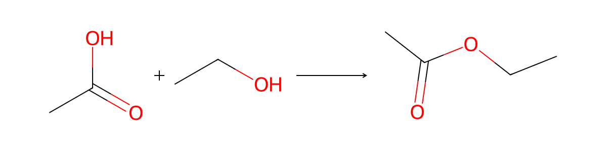
> > [!success]- Conditions & Mechanism
> > **Reaction Type:** Esterification (Condensation)
> > **Reagents:** Carboxylic acid and Alcohol
> > **Conditions:** Concentrated $\ce{H2SO4}$ catalyst, heat under reflux.
> > **Equation:** $\ce{CH3COOH + CH3CH2OH <=> CH3COOCH2CH3 + H2O}$
> >
> > *Tutor tip:* This is a reversible equilibrium. Using an acyl chloride instead of a carboxylic acid makes the reaction go to 100% completion at room temperature (producing $\ce{HCl}$ instead of $\ce{H2O}$).

> [!question] Acyl Chloride $\rightarrow$ Amide
> 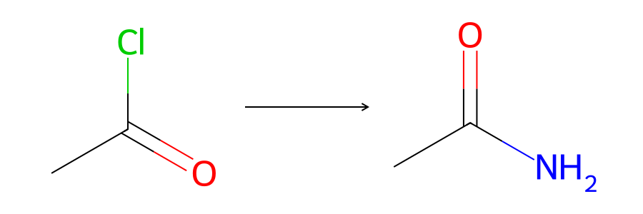
> > [!success]- Conditions & Mechanism
> > **Reaction Type:** Addition-Elimination (Condensation)
> > **Reagents:** Ammonia ($\ce{NH3}$) or a primary/secondary amine.
> > **Conditions:** Room temperature.
> > **Equation:** $\ce{CH3COCl + 2NH3 -> CH3CONH2 + NH4Cl(s)}$
> >
> > *Tutor tip:* This is highly vigorous and produces steamy white fumes of $\ce{HCl}$, which immediately react with excess ammonia to form solid white smoke ($\ce{NH4Cl}$).

***

### 6. Nitriles & Nitrogen Compounds
*Nitriles are vital for stepping up the carbon chain and can be easily converted into carboxylic acids or amines.*

> [!question] Nitrile $\rightarrow$ Carboxylic Acid
> 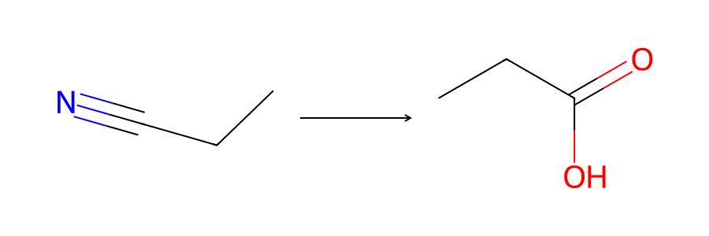
> > [!success]- Conditions & Mechanism
> > **Reaction Type:** Acid Hydrolysis
> > **Reagents:** Dilute strong acid (e.g., $\ce{HCl(aq)}$ or $\ce{H2SO4(aq)}$)
> > **Conditions:** Heat under reflux.
> > **Equation:** $\ce{CH3CH2CN + 2H2O + H+ -> CH3CH2COOH + NH4+}$

> [!question] Nitrile $\rightarrow$ Primary Amine
> 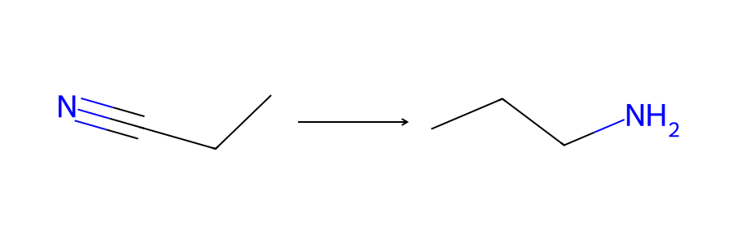
> > [!success]- Conditions & Mechanism
> > **Reaction Type:** Reduction
> > **Reagents:** Lithium tetrahydridoaluminate ($\ce{LiAlH4}$) OR Hydrogen gas ($\ce{H2}$) with a Nickel catalyst.
> > **Conditions:** $\ce{LiAlH4}$ in dry ether; or high pressure/heat for catalytic hydrogenation.
> > **Equation:** $\ce{CH3CH2CN + 4[H] -> CH3CH2CH2NH2}$