# 9701 A-Level Chemistry: Aromatic Synthesis Guide

In the 9701 syllabus, the key to mastering aromatic chemistry is recognising **how the delocalised $\pi$-system changes normal behaviour**. 

### 1. Core Benzene Ring Reactions
*The classic electrophilic substitutions where the stable $\pi$-ring attacks an electrophile, then loses a proton to restore aromaticity.*

> [!question] Benzene $\rightarrow$ Halobenzene (Chlorination / Bromination)
> 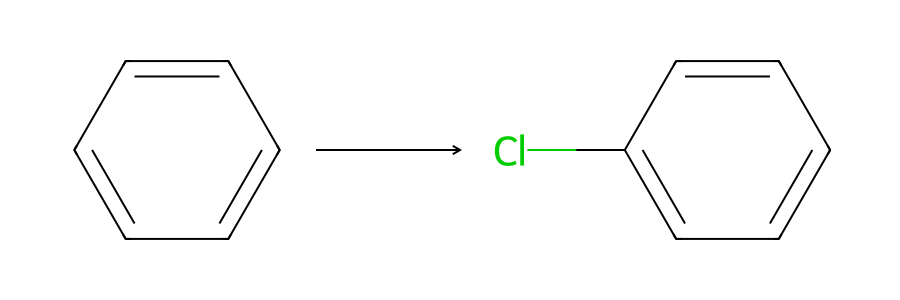
> > [!success]- Conditions & Mechanism
> > **Reaction Type:** Electrophilic Substitution
> > **Reagents:** $\ce{Cl2}$ or $\ce{Br2}$
> > **Conditions:** Halogen carrier catalyst (e.g., $\ce{AlCl3}$, $\ce{FeCl3}$, $\ce{AlBr3}$, or $\ce{Fe}$), room temperature, in the dark.
> > **Equation:** $\ce{C6H6 + Cl2 -> C6H5Cl + HCl}$
> >
> > *Tutor tip:* The catalyst is essential to generate the powerful $\ce{Cl+}$ or $\ce{Br+}$ electrophile because the benzene ring is too stable to polarise the halogen molecule on its own!

> [!question] Benzene $\rightarrow$ Nitrobenzene
> 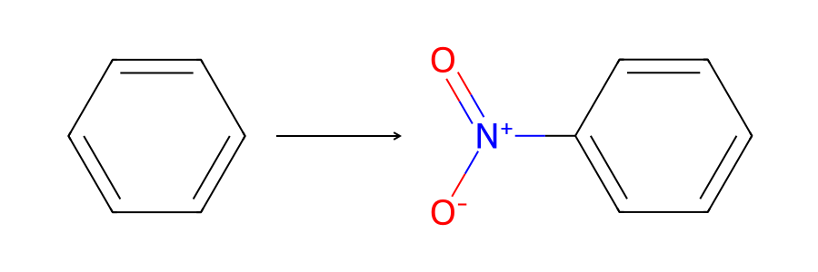
> > [!success]- Conditions & Mechanism
> > **Reaction Type:** Electrophilic Substitution
> > **Reagents:** Concentrated $\ce{HNO3}$ and Concentrated $\ce{H2SO4}$ (Nitrating mixture)
> > **Conditions:** 25 °C – 60 °C (Heating above 60 °C leads to multiple nitrations)
> > **Equation:** $\ce{C6H6 + HNO3 -> C6H5NO2 + H2O}$
> >
> > *Tutor tip:* $\ce{H2SO4}$ acts as an acid catalyst to protonate $\ce{HNO3}$, generating the reactive $\ce{NO2+}$ (nitronium) electrophile.

> [!question] Benzene $\rightarrow$ Alkylbenzene / Acylbenzene (Friedel-Crafts)
> 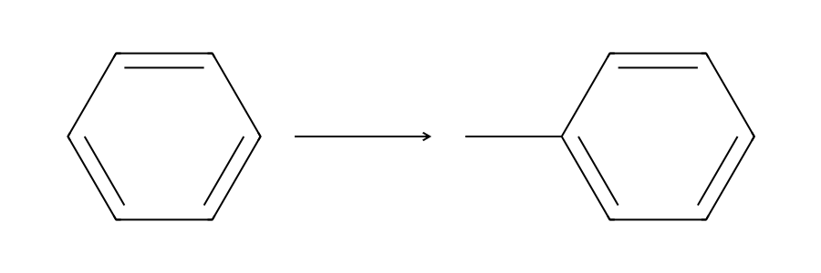
> > [!success]- Conditions & Mechanism
> > **Reaction Type:** Electrophilic Substitution
> > **Reagents:** Halogenoalkane (e.g., $\ce{CH3Cl}$) OR Acyl chloride (e.g., $\ce{CH3COCl}$)
> > **Conditions:** $\ce{AlCl3}$ catalyst, heat under reflux under anhydrous conditions.
> > **Equation (Alkylation):** $\ce{C6H6 + CH3Cl -> C6H5CH3 + HCl}$
> > **Equation (Acylation):** $\ce{C6H6 + CH3COCl -> C6H5COCH3 + HCl}$

> [!question] Benzene $\rightarrow$ Cyclohexane (Destruction of the $\pi$-ring)
> 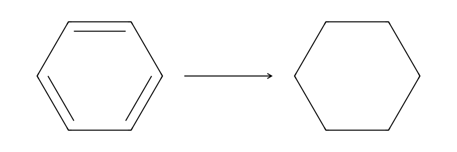
> > [!success]- Conditions & Mechanism
> > **Reaction Type:** Addition (Reduction)
> > **Reagents:** Hydrogen gas ($\ce{H2}$)
> > **Conditions:** $\ce{Pt}$ or $\ce{Ni}$ catalyst, high heat (approx 150 °C) and high pressure.
> > **Equation:** $\ce{C6H6 + 3H2 -> C6H12}$

***

### 2. Alkylbenzenes: Side-Chain vs Ring Competition
*The alkyl group is activating and 2,4-directing, but the benzylic carbon itself is highly susceptible to oxidation and radical attacks.*

> [!question] Alkylbenzene $\rightarrow$ Benzoic Acid (Side-Chain Oxidation)
> 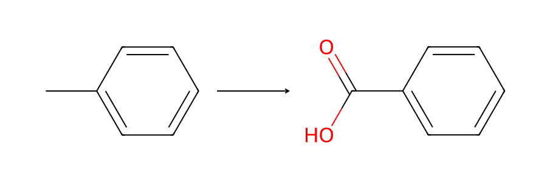
> > [!success]- Conditions & Mechanism
> > **Reaction Type:** Oxidation
> > **Reagents:** Hot, alkaline Potassium Manganate(VII) ($\ce{KMnO4}$), followed by dilute acid ($\ce{H+}$).
> > **Conditions:** Heat under reflux.
> > **Equation:** $\ce{C6H5CH3 + 3[O] -> C6H5COOH + H2O}$
> >
> > *Tutor tip:* It doesn't matter how long the alkyl chain is (e.g., ethyl, propyl); the carbon attached to the ring is *always* oxidised to $-\ce{COOH}$, and the rest of the chain is cleaved off as $\ce{CO2}$ and $\ce{H2O}$!

> [!question] Methylbenzene $\rightarrow$ (Chloromethyl)benzene (Side-chain vs Ring Halogenation)
> 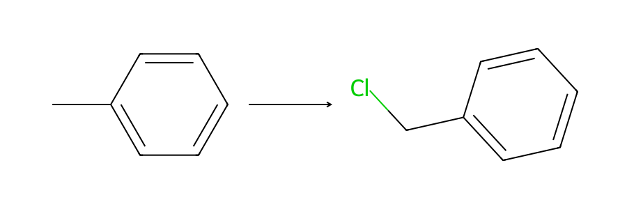
> > [!success]- Conditions & Mechanism
> > **Reaction Type:** Free Radical Substitution (Aliphatic side-chain)
> > **Reagents:** $\ce{Cl2}$ or $\ce{Br2}$ gas
> > **Conditions:** UV light, boiling methylbenzene (NO halogen carrier!).
> > **Equation:** $\ce{C6H5CH3 + Cl2 -> C6H5CH2Cl + HCl}$
> >
> > *Tutor tip:* Examiners love testing this condition contrast! $\ce{Cl2}$ + $\ce{AlCl3}$ = ring substitution (electrophilic). $\ce{Cl2}$ + UV light = side chain substitution (free radical).

> [!question] Alkylbenzene $\rightarrow$ 2- or 4-Substituted Alkylbenzene (Directing Effects)
> 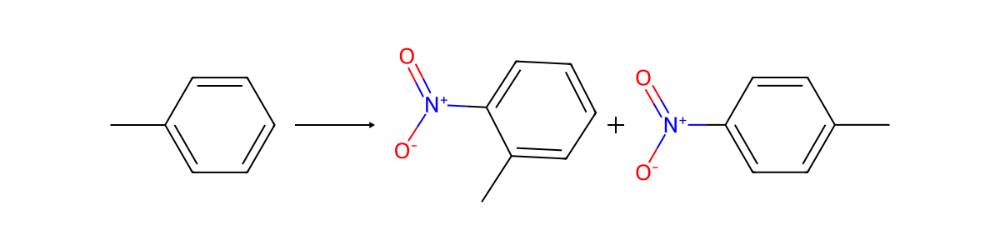
> > [!success]- Conditions & Mechanism
> > **Reaction Type:** Electrophilic Substitution
> > **Reagents:** $\ce{Cl2}$ + $\ce{AlCl3}$ OR Conc $\ce{HNO3}$ + Conc $\ce{H2SO4}$
> > **Conditions:** Same as benzene.
> > **Equation (Nitration):** $\ce{C6H5CH3 + HNO3 -> C6H4(CH3)(NO2) + H2O}$
> >
> > *Tutor tip:* Alkyl groups push electron density into the ring (positive inductive effect), making the ring *more reactive* than benzene and directing incoming electrophiles to the 2 (ortho) and 4 (para) positions. 

***

### 3. Phenol: The Activated Ring & Altered $-\ce{OH}$ Group
*The lone pair on the oxygen partially delocalises into the ring. This makes the ring extremely reactive (activated), but makes the $-\ce{OH}$ group less nucleophilic and more acidic than a normal alcohol.*

> [!question] Phenol $\rightarrow$ 2,4,6-Tribromophenol 
> 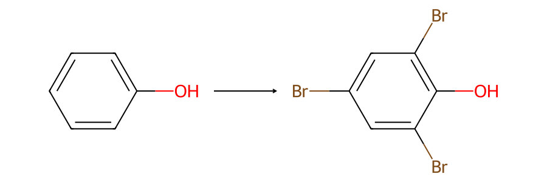
> > [!success]- Conditions & Mechanism
> > **Reaction Type:** Electrophilic Substitution
> > **Reagents:** Aqueous Bromine ($\ce{Br2(aq)}$)
> > **Conditions:** Room temperature. NO catalyst needed.
> > **Equation:** $\ce{C6H5OH + 3Br2 -> C6H2(OH)Br3 + 3HBr}$
> >
> > *Tutor tip:* Visual observation is a classic exam question: Orange bromine water turns **colourless** and a **white precipitate** forms. 

> [!question] Phenol $\rightarrow$ 2-Nitrophenol or 4-Nitrophenol
> 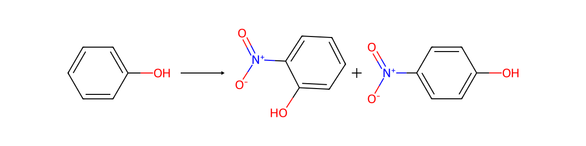
> > [!success]- Conditions & Mechanism
> > **Reaction Type:** Electrophilic Substitution
> > **Reagents:** **Dilute** Nitric Acid ($\ce{HNO3(aq)}$)
> > **Conditions:** Room temperature. NO sulfuric acid catalyst needed!
> > **Equation:** $\ce{C6H5OH + HNO3 -> C6H4(OH)(NO2) + H2O}$

> [!question] Phenol $\rightarrow$ Sodium Phenoxide (Acidity)
> 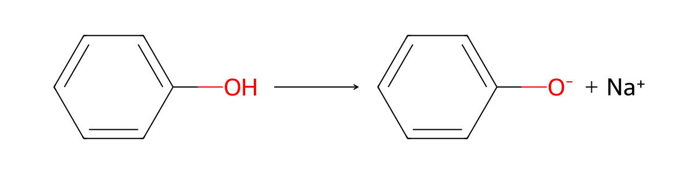
> > [!success]- Conditions & Mechanism
> > **Reaction Type:** Acid-Base Neutralisation
> > **Reagents:** Aqueous Sodium Hydroxide ($\ce{NaOH}$) or Sodium metal ($\ce{Na}$)
> > **Conditions:** Room temperature. 
> > **Equation:** $\ce{C6H5OH + NaOH -> C6H5O-Na+ + H2O}$
> >
> > *Tutor tip:* Unlike aliphatic alcohols, phenol is acidic enough to react with strong bases like $\ce{NaOH}$. However, it is *not* acidic enough to react with carbonates (no fizzing with $\ce{Na2CO3}$), distinguishing it from carboxylic acids.

> [!question] Phenol $\rightarrow$ Phenyl Ester (Altered Esterification)
> 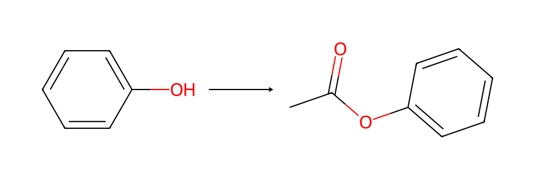
> > [!success]- Conditions & Mechanism
> > **Reaction Type:** Condensation (Addition-Elimination)
> > **Reagents:** Acyl chloride (e.g., $\ce{CH3COCl}$) and Phenol (often dissolved in $\ce{NaOH}$ to form the more reactive phenoxide ion).
> > **Conditions:** Room temperature.
> > **Equation:** $\ce{C6H5OH + CH3COCl + NaOH -> CH3COOC6H5 + NaCl + H2O}$
> >
> > *Tutor tip:* Normal alcohols esterify with carboxylic acids + $\ce{H2SO4}$. Phenols **cannot** do this because the delocalisation of the oxygen lone pair makes it a poor nucleophile. You *must* use a highly reactive acyl chloride.

***

### 4. Phenylamine & Diazonium Salts
*Like phenol, the $-\ce{NH2}$ group activates the ring. Furthermore, primary aromatic amines can form unique, unstable diazonium salts.*

> [!question] Nitrobenzene $\rightarrow$ Phenylamine 
> 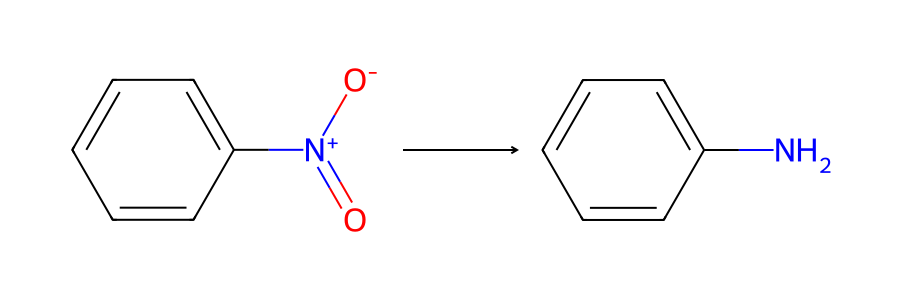
> > [!success]- Conditions & Mechanism
> > **Reaction Type:** Reduction
> > **Reagents:** Tin ($\ce{Sn}$) and Concentrated Hydrochloric Acid ($\ce{HCl}$) 
> > **Conditions:** Heat under reflux. This initially forms the phenylammonium ion ($\ce{C6H5NH3+}$). You must then add $\ce{NaOH(aq)}$ to liberate the free phenylamine.
> > **Equation:** $\ce{C6H5NO2 + 6[H] -> C6H5NH2 + 2H2O}$

> [!question] Phenylamine $\rightarrow$ 2,4,6-Tribromophenylamine
> 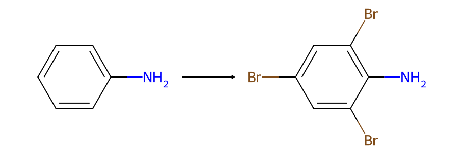
> > [!success]- Conditions & Mechanism
> > **Reaction Type:** Electrophilic Substitution
> > **Reagents:** Aqueous Bromine ($\ce{Br2(aq)}$)
> > **Conditions:** Room temperature, no catalyst. 
> > **Equation:** $\ce{C6H5NH2 + 3Br2 -> C6H2Br3NH2 + 3HBr}$

> [!question] Phenylamine $\rightarrow$ Benzenediazonium Chloride
> 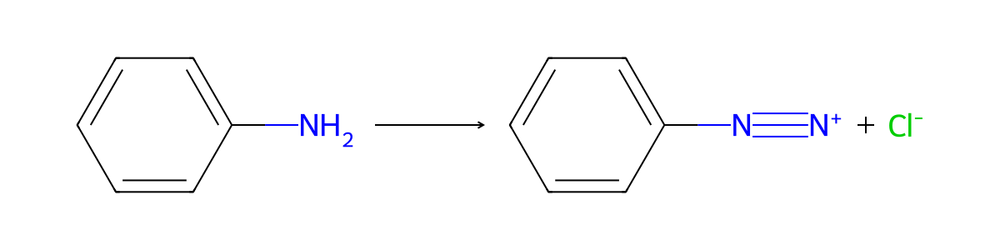
> > [!success]- Conditions & Mechanism
> > **Reaction Type:** Diazotisation
> > **Reagents:** Sodium Nitrite ($\ce{NaNO2}$) and dilute Hydrochloric Acid ($\ce{HCl}$)
> > **Conditions:** Temperature must be strictly maintained **below 10 °C** (usually ~5 °C in an ice bath).
> > **Equation:** $\ce{C6H5NH2 + NaNO2 + 2HCl -> C6H5N2+Cl- + NaCl + 2H2O}$
> >
> > *Tutor tip:* Above 10 °C, the diazonium salt is unstable and decomposes, releasing nitrogen gas and forming phenol.

> [!question] Benzenediazonium Chloride $\rightarrow$ 4-(phenylazo)phenol (Azo Dye)
> 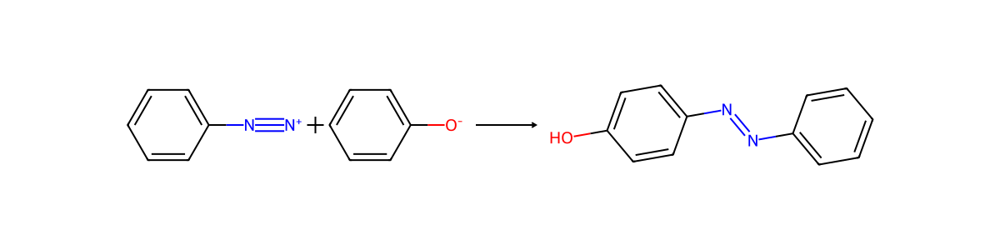
> > [!success]- Conditions & Mechanism
> > **Reaction Type:** Electrophilic Substitution (Coupling)
> > **Reagents:** Phenol dissolved in cold aqueous $\ce{NaOH}$ (forming phenoxide).
> > **Conditions:** Cold (<10 °C). The diazonium ion acts as a weak electrophile and attacks the activated 4-position of the phenoxide ring.
> > **Equation:** $\ce{C6H5N2+ + C6H5O- -> C6H5-N=N-C6H4OH}$
> >
> > *Tutor tip:* This produces highly conjugated, brightly coloured yellow/orange/red precipitates used heavily in the dye industry.

***

### 5. Deactivating Groups
*Groups like $-\ce{COOH}$, $-\ce{NO2}$, and $-\ce{COR}$ withdraw electron density from the ring, making it much harder to substitute, and directing electrophiles to the 3 (meta) position.*

> [!question] Benzoic Acid $\rightarrow$ 3-Nitrobenzoic acid
> 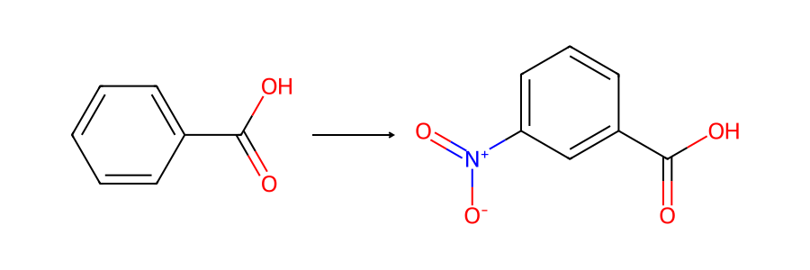
> > [!success]- Conditions & Mechanism
> > **Reaction Type:** Electrophilic Substitution
> > **Reagents:** Conc $\ce{HNO3}$ + Conc $\ce{H2SO4}$
> > **Conditions:** Requires higher heating than benzene because the $-\ce{COOH}$ group is an electron-withdrawing, deactivating group.
> > **Equation (Nitration):** $\ce{C6H5COOH + HNO3 -> C6H4(COOH)(NO2) + H2O}$
> >
> > *Tutor tip:* If you are given a multi-step synthesis, **the order of steps matters**. If you want 4-bromobenzoic acid from methylbenzene, you must brominate *first* (while the $-\ce{CH3}$ is 4-directing), then oxidise *second*. If you oxidise first, the $-\ce{COOH}$ will force the bromine to the 3-position!